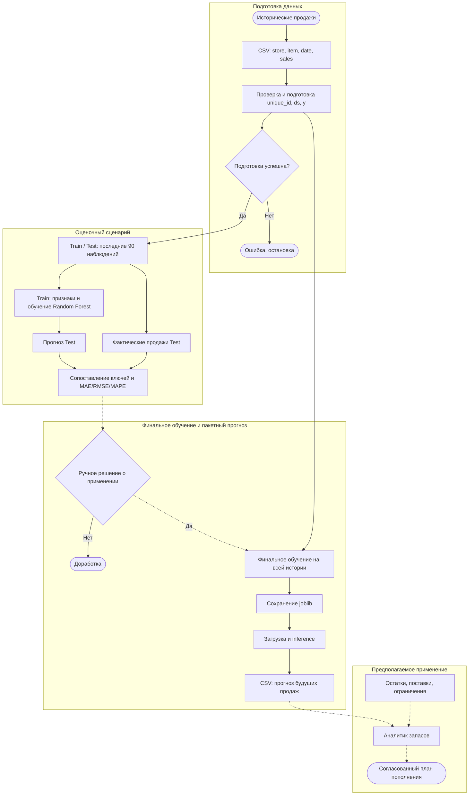

# Бизнес-процесс прогнозирования продаж и планирования запасов

Адаптация структуры [схемы Дарьи](https://github.com/romanenkodaria-prog/Time_series_forecasting_Daria/blob/main/Model_BPMN.md) под Random Forest. Характеристики модели — в [Model Card](model_card.md).

## Задача и роль модели

Модель прогнозирует ежедневные продажи пары магазин–товар на 90 дней. Random Forest с лагами, скользящими средними и календарными признаками позволяет обучаться на нелинейных зависимостях исторических продаж. Эффективность относительно простых сезонных методов требует сопоставимой оценки. Предполагаемая бизнес-задача — планирование запасов; прогноз дополняется остатками, сроками поставок и ограничениями заказа.

## Диаграмма

Mermaid flowchart — BPMN-подобная схема, не исполняемый BPMN 2.0. Сплошные связи — доступные локальные операции, пунктир — проектируемое применение или ручное решение.

Стрелка C → K означает передачу данных, а не автоматический запуск: финальное обучение — отдельная команда после ручного решения. Артефакт финального обучения отличается от оценочного. Автоматического шлюза качества нет.

| Этап | Вход → результат | Статус |
|---|---|---|
| Подготовка | CSV → unique_id, ds, y | [data.py](src/forecasting/data.py) |
| Оценка | Train/Test → прогноз и метрики | [pipeline.py](src/forecasting/pipeline.py), [evaluate.py](src/forecasting/evaluate.py) |
| Финальное обучение | Вся история → MLForecast | [final_train.py](src/forecasting/final_train.py) |
| Сохранение | Объект → joblib | [model_io.py](src/forecasting/model_io.py) |
| Inference | Артефакт → 90 будущих дат на ряд, CSV | [inference.py](src/forecasting/inference.py) |
| Планирование | Прогноз + остатки и поставки → решение специалиста | Предполагается, не реализовано |

Положительная ошибка (прогноз минус факт) может способствовать излишкам, отрицательная — дефициту. Экономический эффект не измерен. Прогноз не равен заказу; округление и правила пополнения требуют согласования.
