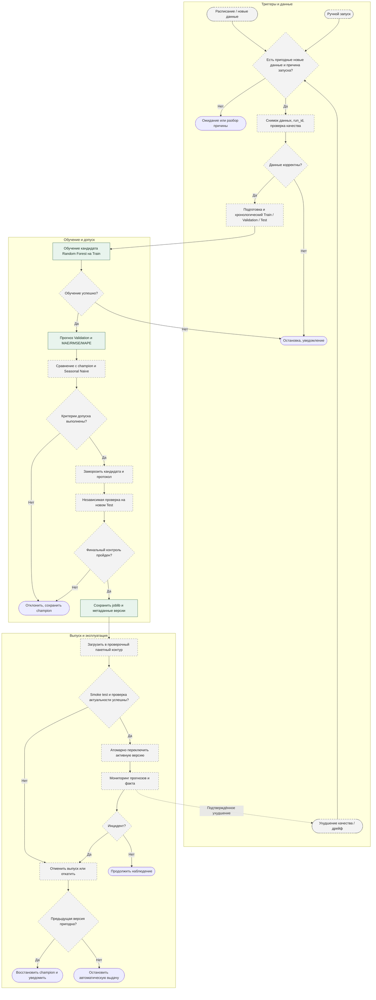

# Процесс автоматического переобучения Random Forest

ДЗ №3. Проектируемый процесс от триггера до выпуска новой версии. Основан на [схеме Дарьи](https://github.com/romanenkodaria-prog/Time_series_forecasting_Daria/blob/main/Model_retrain_BPMN.md), адаптированной к MLForecast и joblib.

## 1. Цель и статус

Поддерживать качество ежедневного прогноза продаж на 90 дней. Локальное обучение, оценка, сохранение, загрузка и пакетный inference реализованы. Оркестрация, автоматические триггеры, реестр, мониторинг и деплой пока проектируются. CI проверяет код, а не переобучает модель. Действующая утверждённая версия (champion) — предполагаемый объект будущей эксплуатации.

## 2. Схема процесса

Mermaid flowchart, не исполняемый BPMN 2.0. Зелёные блоки используют существующие функции, серые — проектируемые компоненты. Автоматические связи между этапами ещё не реализованы.

Любая ошибка подготовки, прогноза, оценки или сохранения блокирует выпуск. Отсутствие нового независимого Test означает ожидание, а не допуск.

## 3. Этапы, входы и результаты

| Этап | Что происходит | Результат для следующего шага |
|---|---|---|
| Триггер | Плановая проверка, новые завершённые продажи, ухудшение метрик, дрейф или ручное решение; дедупликация событий | run_id, причина, граница доступности данных |
| Получение | Сохранить неизменяемый снимок истории с хешем | CSV и версия данных |
| Контроль | Проверить колонки, типы, пропуски, дубликаты, конечность, неотрицательность, непрерывность дат, общие границы и достаточную историю всех рядов | Отчёт качества; при ошибке остановка |
| Подготовка | unique_id, ds, y; общие календарные Train, Validation 90 дней, закрытый Test 90 дней | Манифест выборок |
| Обучение | create_model и train_model только на Train; лаги 1/7/14/28/90, rolling 7/28, календарь | Кандидат, параметры, время обучения |
| Validation | Прогноз на 90 дней; проверка ключей и конечности; MAE/RMSE/MAPE | Метрики на фиксированных рядах и датах |
| Сравнение | Champion и Seasonal Naive (повтор последних 7 дней) на том же окне | Сравнительный отчёт |
| Решение | Проверить заранее утверждённые абсолютные и сравнительные условия | Допуск к независимому Test либо отказ |
| Test | Зафиксировать кандидата и правила, оценить один раз на новом закрытом окне | Финальный отчёт, решение |
| Регистрация | Сохранить joblib под уникальной версией, хеш, метрики, данные, параметры, окружение, статус | Версионный артефакт и манифест |
| Деплой | Загрузить доверенный артефакт в проверочный пакетный контур, проверить формат, даты, число строк, ресурсы и актуальность истории | Проверенная версия; переключение только при успехе |
| Мониторинг | Контролировать ошибки выполнения, дрейф, качество после поступления факта | Отчёт, событие переобучения или инцидент |
| Откат | Восстановить прежний пригодный артефакт и конфигурацию, проверить актуальность прогноза | Восстановление либо ручная эскалация |

## 4. Критерии публикации

Числовые пороги не утверждены. Предлагается заранее согласовать MAE, RMSE, MAPE, групповые показатели и технические ограничения. Для каждой применимой метрики кандидат должен удовлетворять абсолютному порогу T_m и согласованному правилу сравнения с champion и baseline (например, не хуже обоих по основной метрике MAE при допустимых RMSE/MAPE). Это предложение, не действующая политика. NaN MAPE требует заранее согласованного правила; отсутствие оценки не считается успехом. Проверять 90 дат на каждый ожидаемый ряд, отсутствие дубликатов, пропусков и NaN/Inf, допустимость значений. Первый выпуск без champion требует отдельного ручного утверждения.

## 5. Защита от утечки и актуальность модели

Текущий pipeline.py делит историю только на Train/Test по числу наблюдений; для переобучения нужен отдельный календарный Train/Validation/Test. Более 118 строк Train проверяются сейчас только для оставшихся рядов; необходимо проверять все ожидаемые ряды. При двух 90-дневных окнах и текущем минимуме 119 дней Train технический минимум — 299 непрерывных дней на ряд.

Сравнивать champion следует по сохранённым прогнозам, выпущенным до появления факта, либо доказуемо независимому прогнозу. Нельзя сравнивать модель, уже видевшую оцениваемый период, с кандидатом, который его не видел. Test не используется для настройки; после открытия фиксируется в журнале и не применяется повторно для допуска изменённого кандидата. Для следующей независимой кампании нужен новый holdout. Старые окна могут стать историей только после снятия защиты.

Важное ограничение MLForecast: текущий predict_model и inference прогнозируют от конца сохранённой истории. Для Test после Validation потребуется отдельный проверенный способ обновить исторический контекст наблюдениями Validation без изменения обученных деревьев (например, через поддерживаемый API MLForecast после проверки версии). Аналогично перед выпуском нужно обновить контекст до последней доступной даты и проверить прогноз. Это ещё не реализовано. Нельзя просто вызвать predict(h=90) второй раз и считать результат Test.

final_train.py позволяет переобучить лес на всей истории, но создаёт новый артефакт, который не тождественен оценённому кандидату. Для строгого допуска публикуется проверенная версия деревьев с документированным обновлением контекста. Если выбрано финальное переобучение на всей истории, это отдельная версия с отдельной процедурой проверки и утверждения. Нельзя автоматически присваивать ей метрики предыдущего кандидата.

## 6. Версии, деплой и откат

Предлагаемый формат: models/<version>/model.joblib и metadata.json; version включает уникальный run_id. Метаданные содержат хеш артефакта и данных, git commit, параметры, версии библиотек, границы обучения и контекста, метрики, статус допуска. Активная версия определяется отдельным атомарно обновляемым указателем. Не перезаписывать champion до успешной проверки. При откате проверить, что предыдущий артефакт способен прогнозировать актуальные даты; иначе остановить выдачу и уведомить специалиста. Загружать joblib только из доверенного источника.

## 7. Реализовано и предстоит

| Компонент | Сейчас | Для автоматизации |
|---|---|---|
| Данные | [data.py](src/forecasting/data.py) | Полные проверки и снимки |
| Обучение | [train.py](src/forecasting/train.py) | Оркестратор и календарные выборки |
| Оценка | [evaluate.py](src/forecasting/evaluate.py) | Baseline, champion, шлюз и независимый Test |
| Сохранение | [model_io.py](src/forecasting/model_io.py) | Версии, манифест, атомарная публикация |
| Прогноз | [inference.py](src/forecasting/inference.py) | Актуализация контекста и проверочный контур |
| CI | [.github/workflows/ci.yml](.github/workflows/ci.yml) | Отдельный обучающий workflow, если потребуется |
| Эксплуатация | Локальный пакетный запуск | Планировщик, мониторинг, откат |

Периодичность, пороги, ответственные и целевая инфраструктура требуют утверждения. Один новый день данных не обеспечивает независимую оценку всего 90-дневного горизонта. Документ описывает проект процесса, не утверждает, что автоматизация уже внедрена.

Связанные документы: [Model Card](model_card.md), [бизнес-процесс](Model_BPMN.md).
